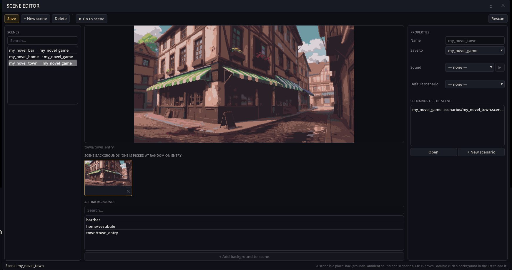

# 场景编辑器 —— 不用手写 JSON 的小说地点

场景编辑器是运行中的游戏上方的窗口，用来编辑视觉小说的地点：场景的背景、声音、默认剧本以及它的剧本列表。保存的场景游戏会立即识别，**▶ 前往场景**会把你带过去，所以你可以搭好一个地点后直接走进去，无需重启。

## 打开方式

按游戏工具栏上的锤子按钮，在工具箱里选择**场景编辑器**。切换场景时窗口保持打开；可以移动、调整大小，用叉号关闭。

## 新建一个地点

1. 按 **+ 新场景**，输入场景 id（拉丁字母、数字和 `_`；`switch_scene` 和剧本文件头会引用它），并在**保存到**中选择模组。
2. 在列表中选一个背景，按 **+ 把背景加入场景**（或双击它）。一个场景可以有多个背景，进入时随机选一个。
3. 选择**声音**（播放按钮可以试听），如有需要再选**默认剧本**——当该场景没有其他剧本可播时播放它。
4. **保存**（Ctrl+S）把 `scenes/<id>.json` 写入所选模组。
5. **+ 新剧本**在所选模组中为这个场景创建剧本文件。若安装了 `scenario_editor`，文件会立即在那里打开；**打开**（或双击）打开场景已有的剧本。
6. **▶ 前往场景**结束当前对话并进入该场景。

## 写入的是谁的文件

一个场景是所有模组中 `scenes/<id>.json` 文件的总和。编辑器只写入**保存到**中所选模组的文件，并且只能选以文件夹形式安装的模组。来自其他模组文件的背景和设置会显示为锁定；修改别人的场景会在你的模组里创建一个补充它的文件。**删除**只删除所选模组的文件。

## 出问题时

- **“打开”是灰色的。** 没有安装剧本编辑器；加入 `scenario_editor`（或“开发者工具”工具集）。仍然可以创建新的剧本文件。
- **“保存到”里没有模组。** 只能写入文件夹模组；打包的 `.zip` 模组是只读的。
- **列表里没有新背景或新声音。** 向模组添加文件后按**重新扫描**。

## 依赖

`tools_base`、`scenario_tools_base`、`dialog_base`、`ui_base`。可选：`scenario_editor`（用于**打开**）。
旧的 `editor_tools` 包会把这个模组和其他创作窗口一起安装。
